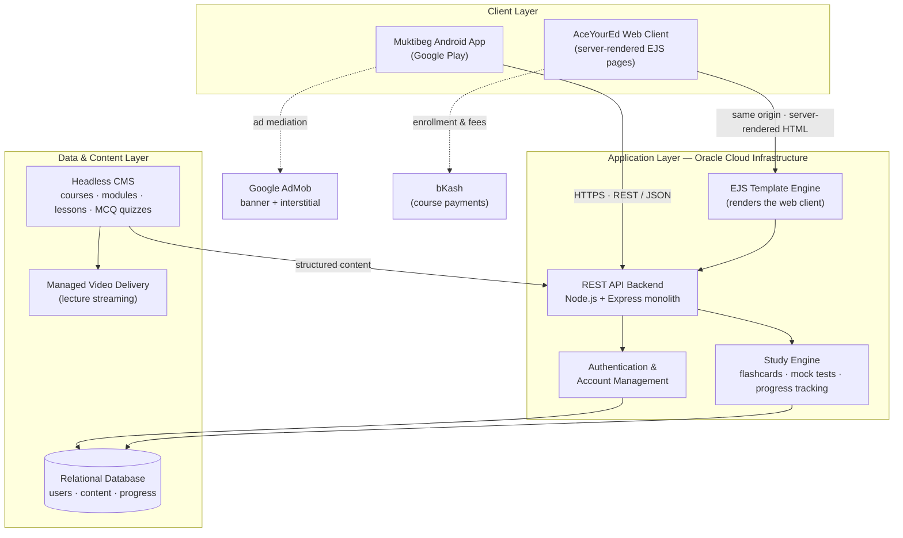

# Muktibeg · Full-Stack Flashcard Learning Ecosystem

[](https://play.google.com/store/apps/details?id=com.muktibeg.flashcards)
[](#tech-stack)
[](#tech-stack)
[](#tech-stack)
[](#monetization-strategy)
[](#live-demo--media)

> **Ace HSC, Medical & Varsity exams with custom mock tests and MCQ flashcards.**

**Muktibeg** (Bengali: মুক্তিবেগ — *"escape velocity"*) is a production-deployed, cross-platform learning ecosystem that helps students in Bangladesh reach escape velocity through the country's most competitive examinations: the **HSC (Higher Secondary Certificate)**, **university ("varsity") admission tests**, and **medical admission tests**.

Excellence comes from systematic study. The ecosystem turns vast, memorization-heavy science syllabi — physics formulas, biology terms, chemistry facts — into a measurable daily study routine: chapter-wise MCQ flashcards with per-card accuracy tracking, custom-built mock tests, and structured study paths, all synchronized behind a single cloud backend.

The ecosystem ships as four connected pieces:

| Piece | What it is |
| --- | --- |
| **Muktibeg for Android** | A free, ad-supported flashcard & mock-test app published on Google Play (release 1.3.x line) |
| **AceYourEd web platform** | A server-rendered learning website with student dashboard, paid video courses, lecture notes, and quizzes |
| **REST API backend** | A single Node.js/Express monolith deployed on Oracle Cloud Infrastructure, serving JSON to the app and rendered HTML to browsers |
| **Content pipeline** | Headless-CMS-managed courses, lessons, and MCQ quizzes — plus ring-bound hardcopy flashcard decks that extend the brand offline |

---

## About This Repository

This is a **client-facing architecture showcase**. The production source code for the mobile app and the web/backend monolith lives in **private repositories** to protect the product's intellectual property.

What this repository documents instead — at a level of abstraction appropriate for clients, collaborators, and technical reviewers:

- what the ecosystem does and who it serves,
- how the mobile app, web client, backend, and data layer fit together,
- the monetization and content-operations strategy, and
- the technology choices behind each layer.

No proprietary business logic, database schemas, API keys, ad publisher IDs, or infrastructure addresses are (or ever will be) shared here.

## Table of Contents

1. [Target Audience & Business Value](#target-audience--business-value)
2. [Key Features](#key-features)
3. [Monetization Strategy](#monetization-strategy)
4. [High-Level Architecture](#high-level-architecture)
5. [Tech Stack](#tech-stack)
6. [Live Demo & Media](#live-demo--media)
7. [Repository Structure](#repository-structure)
8. [Security Notes](#security-notes)
9. [About the Developer](#about-the-developer)

---

## Target Audience & Business Value

**Who it serves.** The primary users are Bangladeshi students preparing for high-stakes, memory-intensive examinations:

- **HSC candidates** (Higher Secondary Certificate — the national grade-12 board exams across science, arts, and commerce tracks),
- **University admission examinees** ("varsity admission") competing for limited seats at public universities, and
- **Medical admission candidates** preparing for the country's most competitive entrance tests.

These students face enormous syllabi, limited structured revision time, and intense competition. The product's value proposition is simple: **replace chaotic cramming with a systematic, trackable study routine**, so every hour of revision is spent on the material the student is actually weakest at.

**Why it works as a business.**

- **Habit-forming engagement loop.** Chapter-wise flashcards with per-card success rates and custom mock tests give students a reason to return daily — engagement that pure courseware cannot match.
- **Multi-channel monetization.** A free ad-supported app acquires and retains users; paid online/offline courses and physical flashcard products monetize the most committed ones (see [Monetization Strategy](#monetization-strategy)).
- **Content velocity without engineering bottlenecks.** Courses, lessons, and quizzes are managed by the content team in a headless CMS — new material ships without code deployments.
- **Lean, fully-owned infrastructure.** A single monolithic backend on Oracle Cloud Infrastructure serves both the mobile API and the web client, keeping cloud costs low and the deployment story simple while remaining horizontally scalable.
- **Offline brand extension.** Ring-bound hardcopy flashcard decks ("pocket study books") bridge the digital product into physical retail, reinforcing the brand in the same market.

---

## Key Features

**Study experience (mobile)**

- **Chapter-wise MCQ flashcard decks** — every subject broken into topics, so students master one theme at a time instead of drowning in the full syllabus.
- **Interactive flip-study flow** — card-by-card active recall that makes memorizing complex formulas and key points faster and more engaging than rereading notes.
- **Custom mock-test builder** — students compose their own exams by choosing subjects, chapters, and time limits, then practice under realistic conditions.
- **Systematic study paths** — a clean, distraction-light interface that turns exam prep into a plannable daily routine rather than an anxiety spiral.

**Progress & insight**

- **Per-card answer history** — the app records how many times each card was attempted and answered correctly.
- **Success-rate analytics** — detailed per-card and per-topic accuracy surfaces exactly where the weak spots are, so revision time is targeted, not guessed.
- **Web dashboard** — the AceYourEd platform extends learning beyond the phone with a student dashboard, built around spaced-repetition study.

**Platform & content**

- **Cross-platform accounts** — one identity system serving both the Android app and the web platform.
- **Structured course catalog** — courses organized into modules and lessons, each combining video lectures, rich-text content, downloadable PDF lecture notes, and attached MCQ quizzes.
- **CMS-driven publishing** — the content team creates and updates courses, quizzes, and questions without touching application code.
- **Bilingual audience reach** — product and content serve a Bangla/English student audience.

---

## Monetization Strategy

The ecosystem monetizes through three complementary channels, designed so that the free experience remains genuinely useful — retention first, revenue second.

**1. Mobile advertising (acquisition & baseline revenue).**
The Android app is free and integrates **Google AdMob** with **banner and interstitial formats**. Placements follow a "natural break points" policy: ads appear at transitions — between study sessions, after results screens — rather than inside an active flashcard run, protecting the core learning experience that drives daily retention. (Ad unit configuration and publisher identifiers are, per security policy, never exposed in this showcase.)

**2. Paid courses (primary conversion).**
The web platform sells structured online courses — video lectures, lecture notes, and quizzes — with separate online and offline (in-person) pricing tiers. Payments are collected through **bKash**, Bangladesh's dominant mobile financial service, removing the credit-card barrier for the target audience.

**3. Physical products (brand extension).**
Ring-bound hardcopy flashcard decks extend the product into physical study routines and open offline sales channels.

**The funnel:** free app → daily study habit → visible progress data → trust in the method → paid course enrollment and physical decks for the deepest-exam-prep needs.

---

## High-Level Architecture

The system is a three-tier, single-backend architecture: two client surfaces (native mobile app + server-rendered web) talking to one Node.js application hosted on Oracle Cloud Infrastructure, backed by a relational database and a headless CMS content pipeline.



**How a typical flow works**

1. **Onboarding** — a student installs the app from Google Play, registers an account, and authenticates against the backend over HTTPS; subsequent requests carry an auth token.
2. **Study session** — the app fetches chapter-wise flashcard decks from the REST API, runs the interactive flip-study flow locally, and reports per-card results back to the study engine, which maintains each student's accuracy history in the relational database.
3. **Mock test** — the student composes a custom mock test (subjects, chapters, time limit); the backend assembles the question set, enforces the timed session, and records the outcome for progress analytics.
4. **Web learning** — the same backend renders the AceYourEd web pages with EJS templates: course catalog, lesson pages (video + notes + quiz), and the student dashboard. One deployable serves both HTML and JSON.
5. **Content operations** — the content team publishes courses, lessons, and MCQ quizzes through the headless CMS; the backend serves that structured content (with lecture video handled by a managed video platform) to both clients.
6. **Monetization touchpoints** — AdMob serves ads to the mobile client at natural break points; course enrollment and fee payment flow through the web client via bKash.

**Design notes**

- **Monolith by choice.** One Express application serves the REST API *and* the server-rendered web client. For a small team, this minimizes deployment complexity, cross-service latency, and operational cost on a single OCI host — while the domain logic remains modular enough to extract services later.
- **Two clients, one brain.** All business rules (progress tracking, scoring, content structure) live server-side, so the Android app and web client never disagree about a student's data.
- **Abstracted data layer.** A relational database persists users, content, and study progress. Schema details are intentionally omitted from this showcase.

---

## Tech Stack

| Layer | Technology |
| --- | --- |
| **Mobile client** | Android application — published on Google Play (release 1.3.x line) |
| **Web client** | EJS server-side templating, rendered by the backend (no separate SPA to ship or hydrate) |
| **Backend** | Node.js + Express — REST API and web serving in a single monolithic application |
| **Database** | Relational SQL database for users, content, and study-progress data |
| **Content management** | Sanity Studio (headless CMS) — courses, modules, lessons, and MCQ quizzes |
| **Media** | Mux managed video delivery for lecture streaming |
| **Cloud** | Oracle Cloud Infrastructure (OCI) — backend hosting |
| **Mobile ads** | Google AdMob — banner and interstitial formats |
| **Payments** | bKash mobile financial service for course fees |

---

## Live Demo & Media

- **Live Play Store Link:** [Muktibeg — HSC & Admission on Google Play](https://play.google.com/store/apps/details?id=com.muktibeg.flashcards)
- **Web platform:** [AceYourEd — spaced repetition learning](https://www.aceyoured.com)
- **Demo Video Link:** [Demo Video Link — placeholder, to be added]
- **Screenshots:** [Screenshots — placeholder, to be added]

Drop production screenshots into `assets/screenshots/` and embed them here:

| Home / Decks | Flashcard Study | Mock Test Builder | Progress Analytics | Web Dashboard |
| :---: | :---: | :---: | :---: | :---: |
| `assets/screenshots/` | `assets/screenshots/` | `assets/screenshots/` | `assets/screenshots/` | `assets/screenshots/` |

---

## Repository Structure

```text
flashcard-ecosystem-architecture/
├── README.md                  # This document — ecosystem architecture showcase
└── assets/
    └── screenshots/           # App & web platform screenshots (to be added)
```

---

## Security Notes

- Application secrets, API keys, database credentials, and ad unit identifiers are held in environment-based configuration on the server and are **never committed** to any repository.
- This showcase deliberately shares no database schemas, proprietary algorithms, or infrastructure addresses.
- For security inquiries, please open a GitHub issue in this repository or reach out via the developer profile below.

---

## About the Developer

**Ali Reza** — software developer and entrepreneur based in Chattogram, Bangladesh, building full-stack products across mobile, web, and cloud.

- GitHub: [AliRezaBmeDu](https://github.com/AliRezaBmeDu)
- Portfolio: [alireza-portfolio-den.netlify.app](https://alireza-portfolio-den.netlify.app/)
- LinkedIn: [mohammad-ali-reza](https://www.linkedin.com/in/mohammad-ali-reza-25686428b/)

---

*This repository documents the architecture of a live production system. Product names and trademarks belong to their respective owners.*
